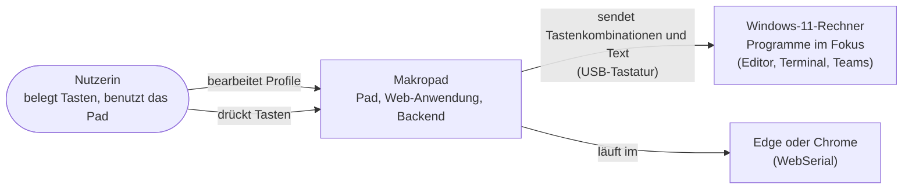
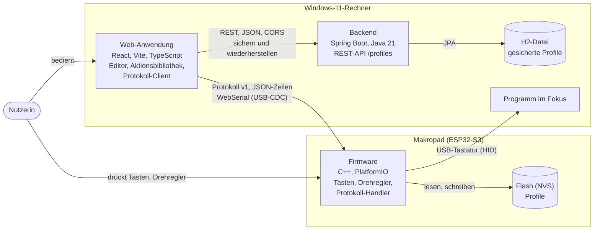

# Architektur (C4)

**Entwurf als Arbeitsgrundlage (Issue #38).** Das Issue verlangt zwei selbst erstellte Diagramme. Diese Fassung
ist aus Code und ADRs abgeleitet und soll vom Autor geprüft, angepasst oder neu gezeichnet werden. Sie gilt
erst als Ergebnis des Issues, wenn der Autor sie übernommen hat.

Grundlage: [Projektdefinition](projektdefinition.md), [Protokoll v1](protokoll-v1.md),
[ADR 0003](adr/0003-firmware-toolchain.md), [ADR 0004](adr/0004-webserial-statt-webhid.md),
[ADR 0005](adr/0005-rolle-des-backends.md).

## Ebene 1: Kontext

Wer nutzt das System und womit hängt es zusammen?

- Das Pad ist für den Rechner eine USB-Tastatur. Es braucht im Betrieb weder Browser noch Hintergrundprogramm (R5).
- Konfiguriert wird nur im Browser, nie am Gerät (R6). Außer Edge oder Chrome gibt es keine Anforderung an den Rechner.
- Nicht dargestellt: GitHub und CI, sie gehören zum Entwicklungsprozess, nicht zum System.

## Ebene 2: Container

Aus welchen laufenden Teilen besteht das System, und wie sprechen sie miteinander?

| Container | Aufgabe | Technik | Quelle |
|---|---|---|---|
| Web-Anwendung | Profile bearbeiten, auf das Pad schreiben, zurücklesen und vergleichen, aus dem Backend sichern und laden | React, Vite, Vitest, WebSerial | `web/` |
| Backend | Kopie der Profile, nur Sicherungsschicht, ohne Anmeldung, lokal betrieben | Spring Boot, H2, JUnit | `backend/`, ADR 0005 |
| Firmware | Tasten entprellen, HID senden, Profile halten und wechseln, Befehle des Protokolls beantworten | C++, ESP32-S3, ArduinoJson | `firmware/`, ADR 0003 |

Wichtige Festlegungen aus den ADRs:

- **Das Pad ist maßgeblich** für den Betrieb, das Backend hält nur eine Kopie. Wiederherstellen überschreibt das Pad
  nur auf ausdrückliche Aktion (ADR 0005).
- **HID und serielle Schnittstelle laufen gleichzeitig** über denselben USB-Anschluss (ADR 0004, Risiko R1, Issue #31).
- **Web-Anwendung und Backend funktionieren unabhängig voneinander.** Ohne Backend fehlen nur Sichern und Laden.
- Das Protokoll ist versioniert, Änderungen daran erst als ADR.
